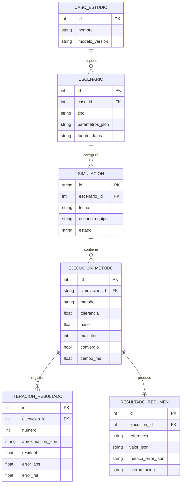

# Diagrama Entidad–Relación (DER inicial)

Diseño de base de datos exigido en la **Semana 1**. La aplicación estática actual conserva simulaciones por `IndexedDB` para permitir recuperar experimentos tras actualizar o cerrar el navegador. Este DER y el script `database/schema.sql` preparan una migración futura a SQLite/PostgreSQL mediante un backend.

## Modelo relacional

- `caso_estudio(id PK, nombre, modelo_version)`.
- `escenario(id PK, caso_id FK, tipo, parametros_json, fuente_datos)`.
- `simulacion(id PK, escenario_id FK, fecha, usuario_equipo, estado)`.
- `ejecucion_metodo(id PK, simulacion_id FK, metodo, tolerancia, paso, max_iter, convergio, tiempo_ms)`.
- `iteracion_resultado(id PK, ejecucion_id FK, numero, aproximacion_json, residual, error_abs, error_rel)`.
- `resultado_resumen(id PK, ejecucion_id FK, referencia, valor_json, metrica_error_json, interpretacion)`.

El diseño almacena **parámetros, escenario, métodos, iteraciones, errores y conclusiones** para garantizar trazabilidad. La implementación actual guarda un objeto integral en IndexedDB; *no se presenta como una BD relacional implementada*.
