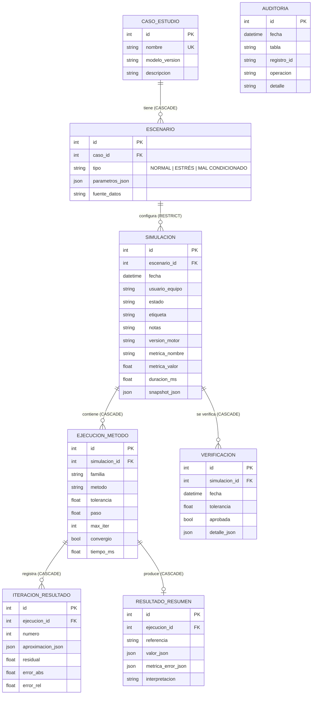

# Diagrama Entidad–Relación y modelo relacional (esquema v2)

La base se implementa en `assets/db/` (motor `SimteleDB`, persistido en IndexedDB) y se exporta a SQLite con el mismo esquema (`database/schema.sql`). El panel **Base de datos** de la aplicación permite ver, insertar, modificar y eliminar registros, ejecutar consultas SQL, exportar/importar y verificar la integridad.

## Modelo relacional

- `caso_estudio(id PK, nombre UNIQUE, modelo_version, descripcion)`
- `escenario(id PK, caso_id FK→caso_estudio, tipo CHECK, parametros_json, fuente_datos, UNIQUE(caso_id, tipo, parametros_json))`
- `simulacion(id PK, escenario_id FK→escenario, fecha, usuario_equipo, estado CHECK, etiqueta, notas, version_motor, metrica_nombre, metrica_valor, metrica_unidad, duracion_ms, snapshot_json)`
- `ejecucion_metodo(id PK, simulacion_id FK→simulacion, familia, metodo, tolerancia, paso, max_iter, convergio, tiempo_ms)`
- `iteracion_resultado(id PK, ejecucion_id FK→ejecucion_metodo, numero, aproximacion_json, residual, error_abs, error_rel, UNIQUE(ejecucion_id, numero))`
- `resultado_resumen(id PK, ejecucion_id UNIQUE FK→ejecucion_metodo, referencia, valor_json, metrica_error_json, interpretacion)`
- `verificacion(id PK, simulacion_id FK→simulacion, fecha, tolerancia, aprobada, detalle_json)`
- `auditoria(id PK, fecha, tabla, registro_id, operacion CHECK, detalle)`

Integridad: claves foráneas con `ON DELETE CASCADE` (salvo `escenario → simulacion`, que es `RESTRICT` para no perder experimentos al borrar un escenario), `CHECK` en `tipo`, `estado`, `operacion` y booleanos, `UNIQUE` en nombres y en (ejecución, número), y validación de JSON.
